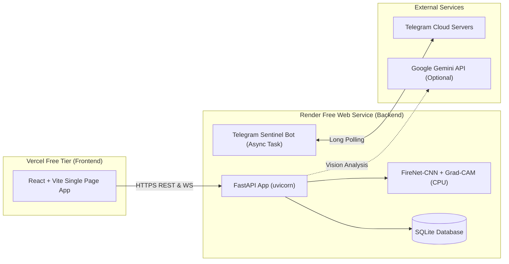

# Cloud Deployment Guide: Render & Vercel (100% Free Tier)

This guide walks you through deploying the **Real-Time Forest Fire Detection System (FireNet-CNN + Explainable AI + Telegram Sentinel Bot)** to the public internet completely free using:
- **Render** for the Python FastAPI backend, trained PyTorch FireNet model, SQLite database, and asynchronous Telegram Sentinel Bot.
- **Vercel** for the React + Vite frontend single-page web dashboard.

---

## Architecture Overview



---

## Step 1: Push Project to GitHub

Make sure your repository has all current changes and the model checkpoint committed.

1. Open PowerShell or Terminal in the project root:
   ```powershell
   git status
   ```
2. Add all files (the `.gitignore` is already configured to include `artifacts/checkpoints/firenet_best.pt`):
   ```powershell
   git add .
   git commit -m "Configure production deployment for Render and Vercel"
   git push origin main
   ```

---

## Step 2: Deploy Backend to Render (Free)

Render provides free Linux Web Services. We configure PyTorch to use CPU-only wheels so it compiles and boots in under 2 minutes within the 512MB RAM free limit.

### Option A: Using Blueprint (`render.yaml`) - Recommended
1. Sign up or log in to [render.com](https://render.com).
2. Click **New +** > **Blueprint**.
3. Connect your GitHub repository.
4. Render will automatically detect `render.yaml`.
5. Enter your secret environment variables when prompted:
   - `TELEGRAM_BOT_TOKEN`: Your Telegram Bot token from @BotFather.
   - `TELEGRAM_CHAT_ID`: Your personal or group chat ID.
   - `GEMINI_API_KEY`: (Optional) Your Gemini API Key from Google AI Studio.
6. Click **Apply**.

### Option B: Manual Web Service Setup
If you prefer configuring through the Render UI:
1. Click **New +** > **Web Service**.
2. Select **Build and deploy from a Git repository** and pick your repo.
3. Configure the settings:
   - **Name**: `forest-fire-sentinel-api` (or any name you like)
   - **Language / Runtime**: `Python`
   - **Branch**: `main`
   - **Region**: `Oregon (US West)` or nearest region
   - **Build Command**:
     ```bash
     pip install --upgrade pip && pip install torch torchvision --index-url https://download.pytorch.org/whl/cpu && pip install -r requirements.txt
     ```
   - **Start Command**:
     ```bash
     uvicorn backend.main:app --host 0.0.0.0 --port $PORT
     ```
   - **Instance Type**: `Free`
4. Expand **Environment Variables** and add:
   - `PYTHON_VERSION`: `3.11.8`
   - `ENVIRONMENT`: `production`
   - `DATABASE_URL`: `sqlite:///./data/firenet.db`
   - `MODEL_CHECKPOINT_PATH`: `artifacts/checkpoints/firenet_best.pt`
   - `CORS_ORIGINS`: `*`
   - `RUN_BOT_IN_API`: `true`
   - `TELEGRAM_NOTIFICATIONS_ENABLED`: `true`
   - `TELEGRAM_BOT_TOKEN`: `<your-telegram-bot-token>`
   - `TELEGRAM_CHAT_ID`: `<your-telegram-chat-id>`
   - `GEMINI_API_KEY`: `<your-gemini-key>` *(optional)*
5. Click **Deploy Web Service**.
6. Wait for the build logs to show `Application startup complete`.
7. Copy your backend service URL (e.g., `https://forest-fire-sentinel-api.onrender.com`).

---

## Step 3: Deploy Frontend to Vercel (Free)

1. Sign up or log in to [vercel.com](https://vercel.com).
2. Click **Add New...** > **Project**.
3. Import your GitHub repository.
4. In the **Configure Project** screen:
   - **Framework Preset**: `Vite`
   - **Root Directory**: Click `Edit` and select `frontend` (or leave default if importing root, as `vercel.json` will handle builds).
   - **Build Command**: `npm run build`
   - **Output Directory**: `dist`
5. Expand **Environment Variables**:
   - Name: `VITE_API_URL`
   - Value: `https://<your-render-backend-name>.onrender.com` *(paste your Render URL without trailing slash)*
6. Click **Deploy**.
7. In ~1 minute, Vercel will give you a public production URL (e.g., `https://forest-fire-sentinel.vercel.app`).

---

## Step 4: Verification Checklist

1. **Backend Health Check**:
   - Open `https://<your-render-backend>.onrender.com/api/v1/health` in your browser.
   - It should return `{"status": "ok", ...}`.
2. **Interactive API Docs**:
   - Open `https://<your-render-backend>.onrender.com/docs` to see Swagger UI.
3. **Frontend Dashboard**:
   - Open your Vercel URL.
   - Test **Live Monitoring**, **Image Upload**, and **Detection History**.
4. **Telegram Bot**:
   - Send `/status` or `/help` to your bot in Telegram.
   - It will reply from the Render cloud container!
   - Upload a fire test image in the dashboard and verify you receive an instant alert on Telegram with Grad-CAM heatmap attached.

---

## Free Tier Tips & Best Practices

> [!NOTE]
> **Render Free Tier Spin-Down (Cold Start)**:
> Free instances on Render go to sleep after 15 minutes of inactivity. When a new request arrives, it takes ~30-50 seconds to wake up.
>
> **How to keep it 100% awake for free**:
> 1. Sign up for a free monitor at [cron-job.org](https://cron-job.org) or [uptimerobot.com](https://uptimerobot.com).
> 2. Create an HTTP ping targeting `https://<your-render-backend>.onrender.com/api/v1/health` every 10 or 14 minutes.
> 3. Your backend and Telegram bot will stay active 24/7 at $0 cost!

