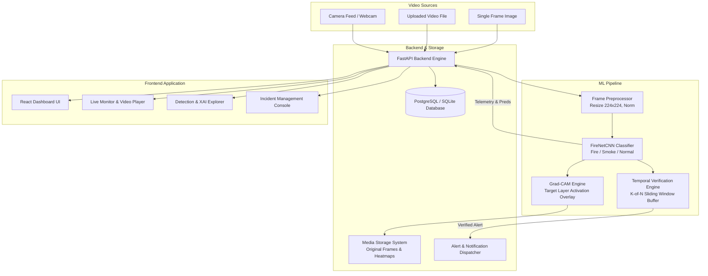

# System Architecture

## 1. High-Level Architecture Overview

The system comprises three primary subsystems:
1. **Machine Learning & Computer Vision Core**: Lightweight `FireNetCNN`, image preprocessors, Grad-CAM visual heatmaps, and sliding-window temporal verification.
2. **Backend API & Processing Engine**: FastAPI server, SQLAlchemy ORM, Alembic migrations, asynchronous video processing workers, and notification dispatchers.
3. **Operator Web Dashboard**: React + TypeScript + Vite responsive user interface featuring live camera feeds, video upload analysis, historical detection logs with Grad-CAM overlays, and incident alert workflows.

---

## 2. Component Specifications

### 2.1 FireNet-CNN Architecture (`ml/model.py`)
- **Input**: Tensor shape `(Batch, 3, 224, 224)`.
- **Feature Extractor**: Four convolutional blocks:
  - Block 1: `Conv2d(3, 16, 3, padding=1) -> BatchNorm -> ReLU -> MaxPool2d(2, 2)`
  - Block 2: `Conv2d(16, 32, 3, padding=1) -> BatchNorm -> ReLU -> MaxPool2d(2, 2)`
  - Block 3: `Conv2d(32, 64, 3, padding=1) -> BatchNorm -> ReLU -> MaxPool2d(2, 2)`
  - Block 4: `Conv2d(64, 128, 3, padding=1) -> BatchNorm -> ReLU -> MaxPool2d(2, 2)`
- **Grad-CAM Target Layer**: Penultimate convolutional layer (`block4.0` or specified target layer), capturing high-level spatial abstractions before global spatial pooling.
- **Classification Head**:
  - `AdaptiveAvgPool2d((1, 1))`
  - `Flatten`
  - `Linear(128, 64) -> ReLU -> Dropout(0.3)`
  - `Linear(64, 3)` (raw logits for `fire`, `smoke`, `normal`).
  - Softmax activation for calibrated inference probabilities.

### 2.2 Grad-CAM Visual Explainability (`ml/gradcam.py`)
1. Forward pass computes class logits.
2. Backpropagation captures gradients $\frac{\partial y^c}{\partial A^k}$ with respect to feature maps $A^k$ of the target convolutional layer.
3. Global average pooling over gradients computes neuron importance weights $\alpha_k^c$:
   $$\alpha_k^c = \frac{1}{Z} \sum_{i} \sum_{j} \frac{\partial y^c}{\partial A_{i,j}^k}$$
4. Weighted combination followed by ReLU retains features that positively contribute to the target class:
   $$L_{\text{Grad-CAM}}^c = \text{ReLU}\left(\sum_{k} \alpha_k^c A^k\right)$$
5. The resulting 2D heatmap is normalized to $[0, 1]$, upsampled via bilinear interpolation to $224 \times 224$ (or original resolution), color-mapped via OpenCV `COLORMAP_JET`, and blended with the original RGB frame with configurable opacity ($\alpha = 0.5$).

### 2.3 Temporal Verification Engine (`ml/temporal_verifier.py`)
To prevent transient spikes (e.g. sun glare or sensor glitches):
- Maintains a rolling ring buffer of size $W$ (default: 5 frames) per camera stream.
- An alert candidate is declared only when $\ge K$ frames (default: 3 frames) exceed the confidence threshold ($T_{\text{fire}} \ge 0.75$, $T_{\text{smoke}} \ge 0.70$).
- Enforces an alert cooldown period (default: 60 seconds) to prevent redundant alerts for the same ongoing incident while keeping other cameras independent.

### 2.4 Database Schema & Persistence
- `cameras`: Camera metadata, streaming endpoints, geographic coordinates, and operational status.
- `detections`: Full inference records, predicted class, probabilities JSON, inference latency, relative media paths for original frames and Grad-CAM heatmaps.
- `alerts`: Verified incidents, severity levels (`CRITICAL`, `WARNING`, `INFO`), incident status (`ACTIVE`, `ACKNOWLEDGED`, `CLOSED`), first/last seen timestamps.
- `settings`: Dynamic threshold parameters (window size, thresholds, cooldowns).
- `notification_logs`: Delivery attempts, channels (console, telegram, email), and timestamps.
